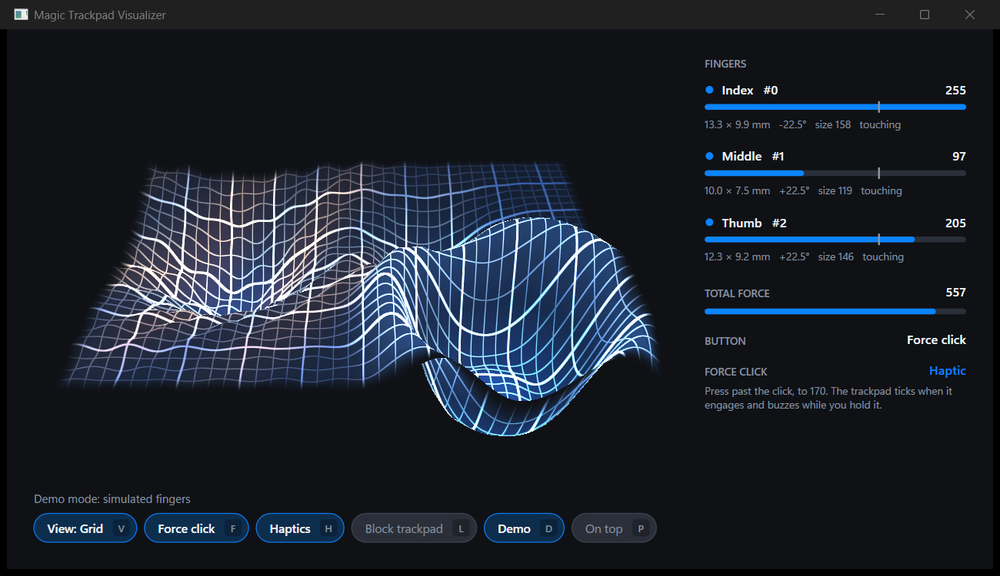
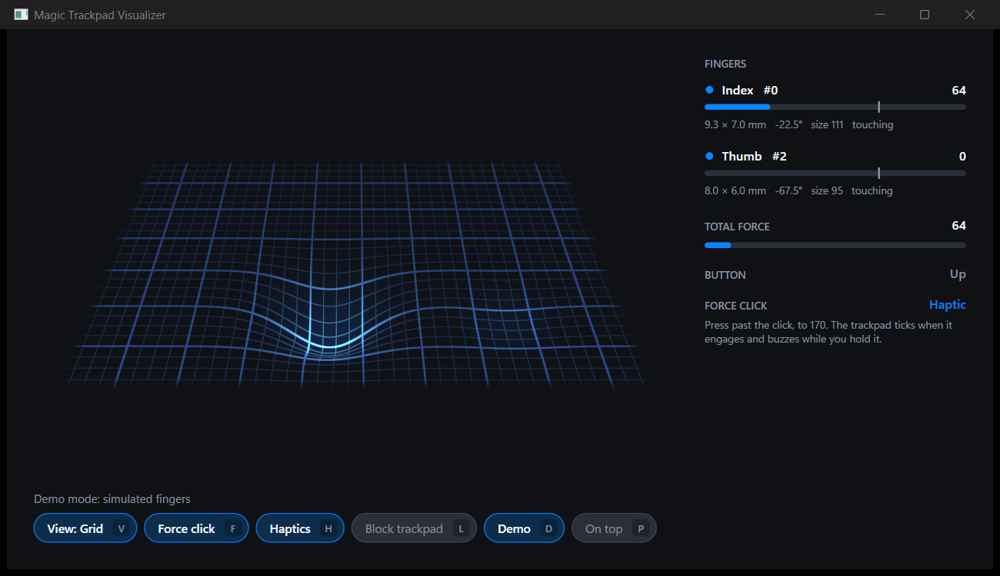
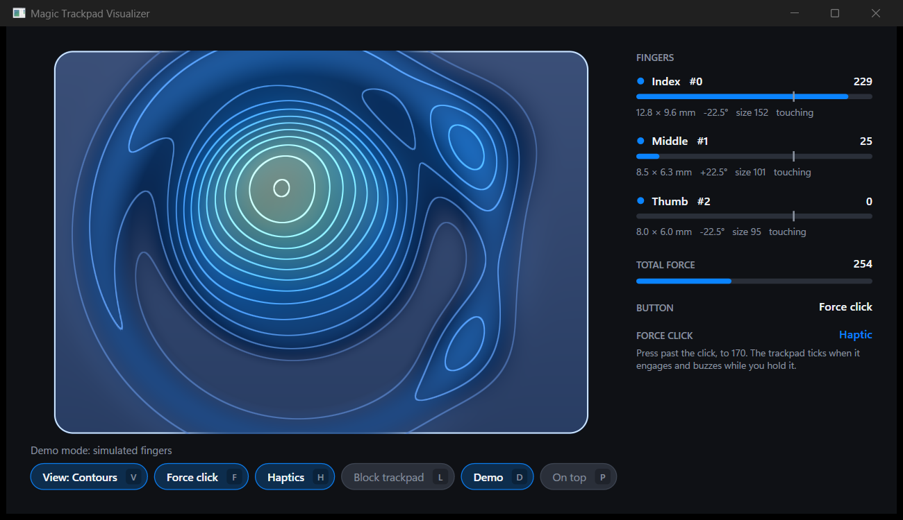
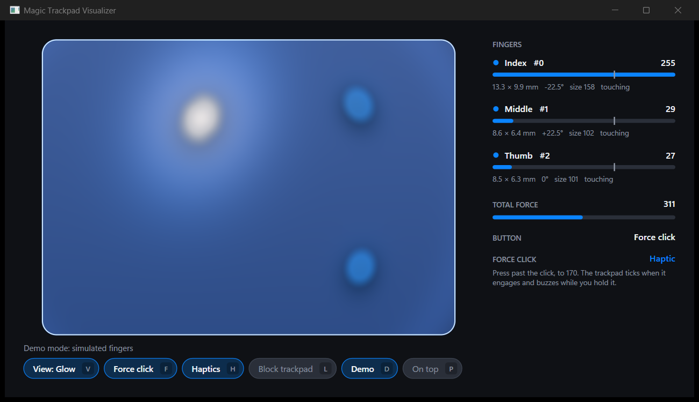

# Magic Trackpad Visualizer

Shows what an Apple Magic Trackpad feels on Windows: every finger, how hard it presses and
the shape of its contact, drawn live on the GPU.

It is a companion to the
[MagicTrackpad2ForWindows](https://github.com/vitoplantamura/MagicTrackpad2ForWindows)
driver, which reports per-finger pressure and contact size and can fire the trackpad's
haptic actuator on demand.



*Screenshots are taken in demo mode, with simulated fingers.*

## What you need

- Windows 10 or 11, 64-bit, with a GPU that supports Direct3D 10 or later.
- A Magic Trackpad running the
  [MagicTrackpad2ForWindows](https://github.com/vitoplantamura/MagicTrackpad2ForWindows)
  driver, version 2.3 or later.
- Two settings in the driver's control panel:

  | Setting | Value | Why |
  | --- | --- | --- |
  | **ADVANCED: Let non-admin apps communicate with the drivers** | Ticked | Lets the visualizer make the trackpad tick and buzz on a force click. After ticking it, switch the trackpad off and on once: the driver reads the setting when the trackpad connects. Without it everything still shows, but the trackpad stays still. |
  | **When you lift your finger from the trackpad** | **Do nothing** | With the other choices the driver holds a finger's reported position still once its pressure or contact size drops low, until it lifts. With several fingers resting lightly, fingers stop following. |

Other Precision Touchpads are shown too, with whatever their reports contain (usually
positions only).

## Download and run

1. Get the zip for your PC from the
   [latest release](https://github.com/casab/MagicTrackpadVisualizer/releases/latest):
   `win-x64` for most PCs, `win-arm64` for ARM devices.
2. Unzip it anywhere and run `MagicTrackpadVisualizer.exe`. Keep the `Shaders` folder next
   to it.

Nothing needs installing; .NET is included. The download is not code-signed, so Windows
may show a SmartScreen warning the first time. It has been tried on Windows 11 on x64; the
ARM64 build comes from the same workflow but has not been tried on an ARM device.

Options:

- `--view grid|contours|glow` picks the view to start with (Grid is the default)
- `--demo` starts with simulated fingers, no trackpad needed
- `--lock` starts with the trackpad kept from driving Windows
- `--log <file.csv>` appends every contact of every report to a CSV file, for diagnostics

## Views

| | |
| --- | --- |
| **Grid**: the pad as a sheet seen at an angle. Every finger presses a dent into it, deeper and wider the harder it presses, and the grid on the sheet bends with it. |  |
| **Contours**: the pad from above with pressure as a height map. Every finger raises a hill drawn with contour lines. |  |
| **Glow**: the pad from above with one soft spot per finger, in the size, shape and angle of the measured contact. |  |

In every view a hovering finger shows faintly, the button and the force click light the pad
up, and a finger that lifts fades out instead of vanishing.

The side panel lists pressure, contact size in mm, orientation, the trackpad's own finger
guess and state for each contact, plus the total force.

## Controls

The row along the bottom of the window. Each control can be clicked or switched with its key.

| Control | Key | |
| --- | --- | --- |
| View | `V` | Steps through the views |
| Force click | `F` | The deeper click stage described below |
| Haptics | `H` | Whether a force click makes the trackpad tick and buzz; off leaves only the visuals |
| Block trackpad | `L` | Keeps the trackpad from driving Windows, see below |
| Demo | `D` | Simulated fingers |
| On top | `P` | Keeps the window above other windows |

## Force click

A second, deeper stage past the ordinary click, like on macOS. The trackpad clicks by
itself at a finger pressure of about 65 (of 255); push on to 170 and that finger's force
click engages:

- a shock wave runs outward from the finger, and the trackpad gives a firm tick;
- while it is held, things around the finger shake and heat up from blue to white hot,
  more the longer it is held (the sheet itself in Grid, the contour lines in Contours, the
  spot in Glow), and the trackpad buzzes: ticks that start much weaker than the first one,
  then get stronger and closer together over 2.5 seconds. The buzz stops after 8 seconds
  of holding;
- easing back below 130 ends it with a lighter tick.

Every finger has its own force click, so several can hold one at once. The notch on each
pressure bar in the side panel marks where it engages.

It is feedback only: Windows is not told about the force click. The ticks and the buzz
need the driver setting from [What you need](#what-you-need); until then the side panel
says "Visual only" and explains why.

## Blocking the trackpad

Switch this on to show the trackpad off without it also driving the PC. The visualizer
keeps showing every finger.

- **With a mouse connected** Windows is told to ignore the trackpad altogether: no pointer,
  clicks, scrolling or gestures, three- and four-finger ones included. The mouse works as
  usual, so the controls stay clickable. This uses Windows' own "leave touchpad on when a
  mouse is connected" switch (Windows 11 24H2 or later), changed for the running session
  only: the stored preference is never written. It is put back when the control is switched
  off or the window closes; if the app is killed while blocking, the next start puts it
  back.
- **Without a mouse** that switch has no effect, so the trackpad's pointer is kept inside
  the visualizer window instead, where it can still click the controls, and clicks or
  scrolling elsewhere are dropped. Windows' three- and four-finger gestures cannot be
  blocked in this case.

The status line says which of the two is in effect.

## How it works

The reports are read through Raw Input and decoded with the HID parser, so the app needs no
special access and works while its window is in the background. The pad is drawn with
Direct3D 11 on its own thread; when nothing is touching and nothing is moving it stops
drawing.

### Adding a view

A view is a pair of HLSL shaders in `src/Shaders/`, compiled when the app starts. Every
view gets the same block of data each frame (`Frame` in `Common.hlsl`): position, pressure
and presence of up to eight fingers, the shape of each contact, each finger's force-click
wave and charge, the time and the button state. To add one, write a `.hlsl` file with a
pixel shader (and a vertex shader if it needs its own geometry), then add a line to `Views`
and a name to `ViewMode` in `src/GpuSurface.cs`. A shader that does not compile is reported
in the status line with the compiler's message.

## Building from source

Requires the .NET 8 SDK. The first build downloads the Direct3D bindings (Vortice) from
NuGet.

```
dotnet run -c Release --project src/MagicTrackpadVisualizer.csproj
```

Every push is built by the `Build` workflow. Pushing a tag such as `v1.2.3` also publishes
a release with the x64 and ARM64 downloads attached.

## License

[GPL-2.0](LICENSE), the same as the driver.
